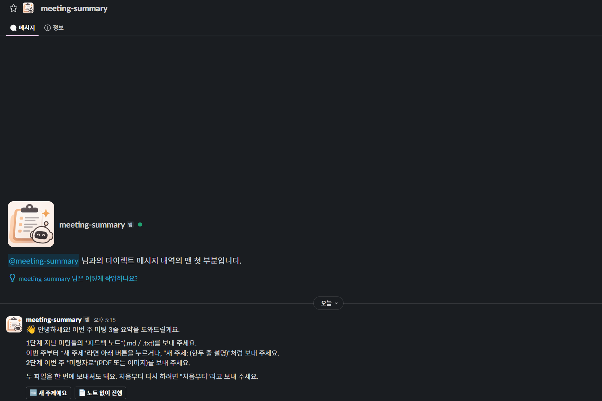

# 미팅 3줄 요약 봇

Slack DM으로 이번 주 미팅자료와 피드백 노트를 보내면, 교수님 양식의 3줄 요약을 만들어 돌려주는 봇입니다. 요약은 Anthropic API의 Claude Sonnet 5.5가 씁니다. 문장은 한국어로 쓰고, 모델·벤치마크·방법·지표 같은 중요한 단어는 영어 그대로 둡니다.

Slack에는 아래처럼 번호와 라벨이 굵게 표시된 카드로 올라옵니다.

```
미팅 자료: week10_meeting.pdf          ← 클릭하면 올린 파일로 이동
─────────────────────────────
오늘 미팅 자료에 대한 3줄 요약은 다음과 같습니다.

1. 지난 미팅                                 ← 새 주제면 "1. 새 주제"
지난 미팅 피드백과, 그에 따라 이번에 한 일

2. 이번 결과
이번 실험과 결과 (예상과 다르면 그 차이와 원인 가설)

3. 논의 · Todo
의견을 받고 싶은 점과 구체적인 next step
```

## 사용법

Slack 왼쪽의 **앱**에서 봇을 찾아 **DM**을 열면 봇이 먼저 인사하고, 두 단계로 안내합니다.



```
봇   👋 안녕하세요! 이번 주 미팅 3줄 요약을 도와드릴게요.
     1단계 지난 미팅들의 피드백 노트(.md / .txt)를 보내 주세요.
           새 주제라면 버튼을 누르거나 "새 주제: (한두 줄 설명)"처럼 보내 주세요.
     2단계 이번 주 미팅자료(PDF 또는 이미지)를 보내 주세요.
     [🆕 새 주제예요] [📄 노트 없이 진행]

나   (feedback.md 첨부)
봇   ✅ 피드백 노트를 확인했어요: feedback.md
     이제 2단계로 이번 주 미팅자료(PDF 또는 이미지)를 보내 주세요 📄

나   (week10_meeting.pdf 첨부)
봇   🙌 자료를 모두 받았어요! 지금 읽고 3줄 요약을 쓰고 있어요. … 잠시만 기다려 주세요 ⏳
     → 30초~1분 뒤 이 메시지가 요약 카드로 바뀝니다
봇   ✨ 요약을 마쳤어요. 다른 미팅 자료도 요약하려면 아래 버튼을 눌러 주세요.
     [🔄 새 요약 시작하기]          ← 누르면 처음 인사부터 다시 시작
```

| 단계 | 보내는 것 | 쓰임 |
|---|---|---|
| 1단계 | 피드백 노트 `.md` / `.txt`, **또는** 새 주제 알림(버튼이나 "새 주제: …") | 1번 줄. 새 주제면 노트 대신 새 주제 설명을 바탕으로 쓰고 라벨이 "새 주제"가 됩니다 |
| 2단계 | 이번 주 미팅자료 PDF / 이미지 | 요약의 근거 |
| 언제든 | 텍스트 메모 | 요약할 때 함께 참고합니다 |

- 순서를 바꾸거나 한 메시지에 다 보내도 됩니다. 미팅자료가 먼저 오면 봇이 1단계를 물어보고, 노트 없이 바로 요약하는 버튼도 줍니다.
- 요약이 끝나거나 오류가 나면 **[🔄 새 요약 시작하기]** 버튼이 붙습니다. 누르면 인사부터 다시 시작합니다. 중간에 처음부터 다시 하려면 "처음부터", 안내를 다시 보려면 "도움말"이라고 보냅니다. 보낸 내용은 2시간 동안 기억하고, 요약이 끝나면 비워집니다.
- 채널에서는 `@meeting-summary`를 멘션하면서 보내면 같은 방식으로 thread에서 진행됩니다.
- 요약 카드는 그대로 복사해서 미팅 채널에 올리면 됩니다.
- 자료가 부족하거나 확인할 점이 있으면 `💡 참고:` 메시지가 하나 더 붙습니다. 학생에게만 보여 주는 메모라서 복사할 때는 빼면 됩니다.
- 봇은 자료에 없는 수치를 지어내지 않습니다. 결과가 빈약하면 쓸 수 있는 만큼만 씁니다.
- 슬라이드(pptx), Keynote, 노션 링크는 직접 읽지 못합니다. PDF로 내보내서 올려 주세요.

### 피드백 노트 예시

미팅이 끝날 때마다 위에 한 블록씩 추가해 두면, 다음 요약의 1번 줄이 좋아집니다. 최신 미팅을 맨 위에 둡니다.

```markdown
# Efficient VLM: Token Pruning   (가상의 예시)

## 2026-10-22 미팅
- 교수님 피드백: pruning ratio만 바꾸지 말고, pruning을 적용하는 layer 위치별로 ablation 해 볼 것
- 다음 계획: layer 위치별 ablation, ChartQA 실패 케이스 확인

## 2026-10-08 미팅
- 교수님 피드백: ...
```

새 프로젝트를 시작했다면 1단계에서 "새 주제"를 알려 주세요. 이전 주제의 피드백이 1번 줄에 섞이지 않습니다.

## Claude Code / Codex skill로 쓰기

이 폴더는 skill(`SKILL.md`)이기도 합니다. 링크해 두면 Claude에게 "미팅 요약 봇 실행해줘", "요약이 너무 길어, 규칙 고쳐줘", "봇이 응답을 안 해"처럼 부탁해서 설정, 실행, 테스트, prompt 수정을 맡길 수 있습니다.

```bash
ln -s "$HOME/claude-skills-wiki/skills/meeting-summary-bot" "$HOME/.claude/skills/meeting-summary-bot"
```

`.env`처럼 개인 정보가 담긴 파일은 이 폴더 안에 두면 되고, git에서 제외되어 있어 commit되지 않습니다.

## 동작 방식

```
Slack (DM / @멘션, 파일·버튼)
  │  Socket Mode: 서버에서 Slack으로 나가는 연결만 쓰므로 공개 주소가 필요 없습니다
  ▼
meeting_bot (서버 tmux에서 상시 실행)
  1. 대화 상태를 사람별로 메모리에 보관 (1단계 노트/새 주제, 2단계 미팅자료, 메모)
     파일은 도착할 때 형식과 크기만 검사하고, 아직 내려받지 않음
  2. 두 단계가 모이면 "요약하는 중" 메시지를 올리고, 그때 Slack에서 파일을 메모리로 내려받음
  3. Anthropic Messages API 1회 호출
     - PDF는 document block, 이미지는 image block, 피드백 노트는 text로 전달
     - structured outputs로 last_meeting / this_week / discussion / new_topic / notes 필드를 강제
     - adaptive thinking + effort `medium` (SUMMARY_EFFORT로 조정)
     - Sonnet 5.5가 거절하면 서버 쪽 fallback(`fallbacks: "default"`)으로 다른 모델이 이어서 처리
  4. "요약하는 중" 메시지를 요약 카드(Block Kit)나 오류 안내로 교체
```

- 요청은 동시에 최대 `MAX_CONCURRENT_JOBS`개까지 처리합니다. 한 사람이 처리 중일 때 다시 보내면 기다려 달라고 안내합니다.
- 파일은 서버 디스크에 저장하지 않습니다. 로그에는 사용자 ID, 파일 수, 토큰 사용량, 소요 시간만 남고 자료 내용은 남지 않습니다.
- 자료는 요약을 위해 Anthropic API로 전송됩니다.

## 설치 (관리자)

### 1. Slack 앱 만들기

1. [api.slack.com/apps](https://api.slack.com/apps?new_app=1)에서 **From a manifest**를 고르고, 워크스페이스를 선택한 뒤 이 저장소의 [`slack_manifest.yaml`](slack_manifest.yaml)을 붙여 넣습니다. 권한, DM, 버튼(interactivity), 인사 이벤트, Socket Mode가 모두 manifest에 들어 있습니다.
2. **Install to Workspace**를 누릅니다. 워크스페이스 설정에 따라 관리자 승인이 필요할 수 있습니다.
3. **OAuth & Permissions**에서 Bot User OAuth Token(`xoxb-…`)을 복사합니다. 이 값이 `SLACK_BOT_TOKEN`입니다.
4. **Basic Information → App-Level Tokens**에서 `connections:write` scope로 토큰(`xapp-…`)을 만듭니다. 이 값이 `SLACK_APP_TOKEN`입니다.
5. 채널에서 쓰려면 그 채널에 봇을 초대합니다(`/invite @meeting-summary`). DM은 초대 없이 바로 쓸 수 있습니다.

### 2. Anthropic API key

[Claude Console](https://platform.claude.com/)에서 API key를 만듭니다. 사용량은 key를 만든 조직에 청구되므로, Console에서 월 사용 한도(spend limit)를 걸어 두는 것을 권장합니다.

> 여러 사람이 쓰는 봇이므로 개인 Claude 구독(Pro/Max) 로그인이 아니라 Console API key를 씁니다. Anthropic은 구독 계정으로 다른 사람의 요청을 대신 처리하는 것을 허용하지 않습니다.

### 3. 서버에서 실행

Python 3.10 이상이 필요합니다.

```bash
git clone https://github.com/mlilab/claude-skills-wiki.git "$HOME/claude-skills-wiki"
cd "$HOME/claude-skills-wiki/skills/meeting-summary-bot"
python3 -m venv .venv && source .venv/bin/activate
pip install -e .

cp .env.example .env && chmod 600 .env   # ANTHROPIC_API_KEY, SLACK_BOT_TOKEN, SLACK_APP_TOKEN 입력

# Slack 없이 먼저 확인: 로컬 파일로 요약을 출력합니다
python -m meeting_bot summarize slides.pdf notes.md --note "새 주제입니다"

# 봇 실행
python -m meeting_bot
```

### 4. 상시 실행 (tmux)

```bash
tmux new -s meeting-bot
cd "$HOME/claude-skills-wiki/skills/meeting-summary-bot" && source .venv/bin/activate && python -m meeting_bot
# 빠져나오기: Ctrl-b d   /   다시 붙기: tmux attach -t meeting-bot
```

봇은 **한 Slack 앱당 한 곳에서만** 실행합니다. 같은 토큰으로 두 개를 띄우면(다른 서버, 잊고 남겨 둔 tmux 창) Slack이 메시지를 두 프로세스에 나눠 보내서 대화가 엇갈립니다. 랩 멤버들은 각자 봇을 띄울 필요 없이, 이미 떠 있는 봇에 DM만 보내면 됩니다.

## 설정

`.env`에 넣습니다. 예시는 [`.env.example`](.env.example)에 있습니다.

| 변수 | 기본값 | 설명 |
|---|---|---|
| `ANTHROPIC_API_KEY` | (필수) | Console API key |
| `SLACK_BOT_TOKEN` | (필수) | `xoxb-…` |
| `SLACK_APP_TOKEN` | (필수) | `xapp-…`, scope `connections:write` |
| `SUMMARY_MODEL` | `claude-sonnet-5-5` | 요약에 쓸 모델. API에는 "latest" alias가 없어서 정확한 ID로 고정합니다. 새 Sonnet이 나오면 이 값만 바꾸고 `summarize`로 확인합니다 |
| `SUMMARY_EFFORT` | `medium` | `low` / `medium` / `high` / `xhigh` / `max`. 생각하는 깊이입니다. 높을수록 느리고 비용이 늘어납니다 |
| `SUMMARY_FALLBACK` | `default` | 거절 시 서버 쪽 fallback. 끄려면 `off` |
| `ALLOWED_USER_IDS` | (비움) | 쓸 수 있는 Slack 사용자 ID 목록(쉼표 구분). 비우면 워크스페이스 전원 |
| `ALLOWED_CHANNEL_IDS` | (비움) | 멘션을 받을 채널 ID 목록. 비우면 봇이 있는 모든 채널. DM에는 적용되지 않습니다 |
| `MAX_CONCURRENT_JOBS` | `2` | 동시에 처리할 요청 수 |
| `MAX_FILE_MB` / `MAX_TOTAL_MB` | `20` / `20` | 파일 하나 / 요청 전체 크기 상한 |
| `LOG_LEVEL` | `INFO` | 로그 수준 |

## 요약 규칙 고치기

규칙은 모두 [`meeting_bot/prompt.md`](meeting_bot/prompt.md)에 있습니다. 읽는 사람(교수님)과 목적, 줄별 역할, 언어 규칙, 예시가 들어 있습니다. 규칙에는 이유를 함께 적고, 예시는 가상이라고 표시해 둡니다. 모델이 이유를 알아야 애매한 자료에서도 맞게 판단하고, 예시 하나만 있으면 그 문장 틀을 그대로 베끼기 때문입니다.

고친 뒤에는 `python -m meeting_bot summarize …`로 지난 미팅 자료 몇 개에 돌려 비교하고, 봇을 재시작하면 반영됩니다. effort를 바꿀 때도 같은 방법으로 확인합니다(`SUMMARY_EFFORT=low python -m meeting_bot summarize …`).

## 비용

Sonnet 5.5는 입력 100만 토큰당 $2, 출력 100만 토큰당 $10입니다(2026-10 기준). PDF는 쪽마다 텍스트와 이미지가 함께 들어가서 쪽수에 비례해 늘어납니다. 실제로 미팅 PDF 1건을 요약했을 때 입력 약 54k, 출력 약 1.2k 토큰으로 약 $0.12였습니다. 실제 사용량은 봇 로그의 `usage=` 항목과 Console에서 확인할 수 있습니다.

## 개발

```bash
pip install -e ".[dev]"
pytest              # Anthropic API와 Slack은 fake/mock으로 대체합니다. 네트워크와 key가 필요 없습니다
ruff check . && ruff format --check .
```

```
SKILL.md            # Claude Code / Codex skill 안내 (설정·실행·문제 해결)
slack_manifest.yaml # Slack 앱 설정 (권한, 이벤트, 버튼, Socket Mode)
meeting_bot/
├── __main__.py     # CLI: serve(기본) / summarize
├── config.py       # 환경변수 → 설정
├── files.py        # 파일 분류(미팅자료/피드백 노트), 디코딩, 크기 검사
├── summarizer.py   # Anthropic API 호출, structured output 검증, 오류 안내 문구
├── prompt.md       # 요약 규칙 (system prompt)
├── slack_app.py    # Slack Bolt (Socket Mode), 요청 처리, 동시성 제어
└── formatting.py   # Slack 메시지 문구와 양식
```
