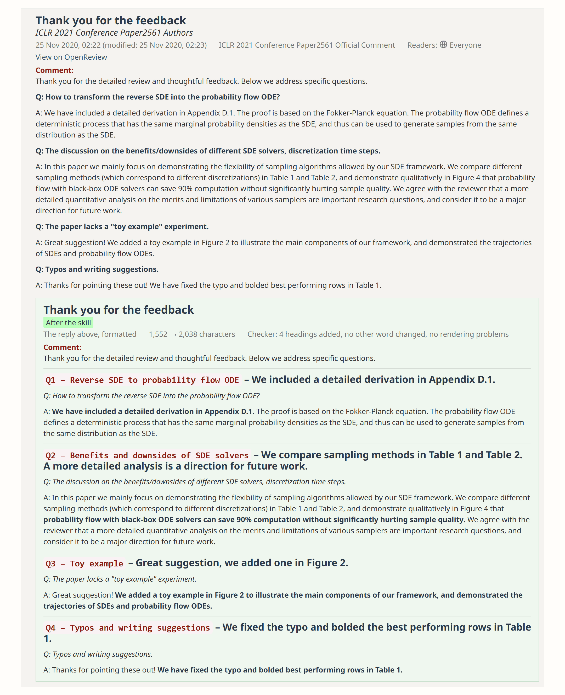

# OpenReview Rebuttal Format

OpenReview Rebuttal Format is a Claude Code skill for author replies on OpenReview. It turns a
rebuttal draft, or notes, into Markdown that renders the way strong published rebuttals do: a
bold heading per reviewer point with its label in red, `---` between points, and bold, red and
italic markers where those rebuttals put them. It keeps your words. Converting a draft changes
only its structure and markup, and every word that does change is listed for you to check.

## What it does

| Feature | What you get |
| --- | --- |
| Point headings | One `###` heading per reviewer point: the point ID and topic in red, then a one-sentence answer that starts with the stance ("Sure, we now added ..."). Points that share an answer share a heading. |
| Markers | Bold for what changed and where, promises for the camera-ready version, the key result and the best value in each table column. Red (backticks) for labels, reviewer IDs, line numbers and case-study verdicts. Italics for reviewer quotes. |
| Rendering fixes | Tables, math, quotes and case studies written so OpenReview shows them as intended: doubled backslashes in math, blank lines before `---` and tables, `\` at the end of quote lines, and PDF page links in place of images. |
| No rewording | The author's sentences stay as written. Every added, removed or changed word, including a new heading, is listed after the Markdown. Overstated claims are flagged, not fixed. |
| AC summary | An end-of-discussion summary for the area chair, with one bullet per concern, a short reviewer quote and what was added. |
| Checker | `scripts/check_openreview_md.py` prints the length as OpenReview counts it, rendering problems by line, and every word that differs between a draft and its formatted version. |

To reword the reply itself, use [Humanize Paper](../humanize-paper/README.md) first, then
format the result with this skill.

## Requirements

- Claude Code, or another agent that reads `SKILL.md` skills.
- Python 3.9+ for the checker. Only the standard library is used, so there is nothing to install.

## Install

```bash
git clone https://github.com/mlilab/claude-skills-wiki.git "$HOME/claude-skills-wiki"
mkdir -p "$HOME/.claude/skills"
ln -s "$HOME/claude-skills-wiki/skills/openreview-rebuttal-format" "$HOME/.claude/skills/openreview-rebuttal-format"
```

If you set `CLAUDE_CONFIG_DIR`, link into `$CLAUDE_CONFIG_DIR/skills` instead.

## Use

Claude uses the skill when you ask for OpenReview Markdown. You can also call it with
`/openreview-rebuttal-format`.

| Ask | Result |
| --- | --- |
| "Format this rebuttal draft as OpenReview md code" | The reply in a fenced Markdown block, then the word changes, the sentences made bold and any claims to check |
| "Write the W2 reply from these notes, with a table of the new results" | A new reply with Table R1 and the best values in bold |
| "Summarize the discussion for the AC" | The area-chair summary, one bullet per concern |
| "My table shows up inside the quote on OpenReview" | The fixed Markdown and the reason |

The checker can also be run by hand:

```bash
python3 scripts/check_openreview_md.py reply.md                  # length and rendering problems
python3 scripts/check_openreview_md.py reply.md --limit 5000     # also check the venue's limit
python3 scripts/check_openreview_md.py --diff draft.md reply.md  # words that differ
```

`examples/draft.md` and `examples/reply.md` are a short draft and its formatted version.
`python3 tests/run_tests.py` checks the checker against them.

## Example

An author reply from the ICLR 2021 discussion of *Score-Based Generative Modeling through
Stochastic Differential Equations*, as posted (gray) and after the skill (green). The checker
found 4 headings added and no other word changed.



## References

- The rendering rules come from OpenReview's frontend source and its Markdown library,
  [marked](https://github.com/markedjs/marked).
